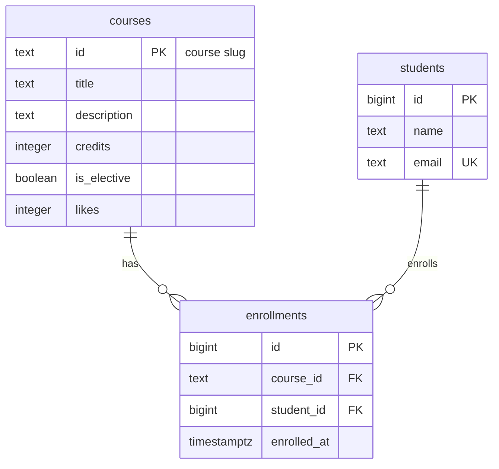

# course-catalog-db

A PostgreSQL database project for a course catalog API (Lab 6, "Advanced Web Technologies"), including schema definition, constraints, seeding, query benchmarking, and transaction isolation testing.

## How to run

PostgreSQL 16 or newer is required. Once, as the `postgres` superuser:

```sql
CREATE ROLE catalog_app LOGIN PASSWORD 'change-me';
CREATE DATABASE course_catalog OWNER catalog_app;
```

Then, from the project folder (it stops at the first error). My server listens on port 5433; with the default port 5432 simply drop the `-p 5433` option:

```bash
psql -h localhost -p 5433 -U catalog_app -d course_catalog -v ON_ERROR_STOP=1 -f schema.sql
psql -h localhost -p 5433 -U catalog_app -d course_catalog -v ON_ERROR_STOP=1 -f seed.sql
psql -h localhost -p 5433 -U catalog_app -d course_catalog -v ON_ERROR_STOP=1 -f queries.sql
```

The password `change-me` is for teaching; real projects keep passwords out of git.

## Schema



There are three tables: `courses`, `students` and `enrollments`. An enrollment references exactly one course and one student through two foreign keys, so `enrollments` is a junction table. The many-to-many relationship between courses and students (a course has many students, a student takes many courses) lives in it, and the pair `(course_id, student_id)` is unique, so a student enrolls in a course only once.

## Design decisions

- **`courses.id` is text, `students.id` is an automatic number.** A slug such as `modern-frontend` is human-readable, already used in the API URLs (`/courses/modern-frontend`), and needs no extra lookup; the downside is that it is longer than a number and hard to rename, because every referencing row would have to change. A student has no natural stable key (a name repeats, an email can change), so a meaningless surrogate `bigint` identity is used: it is small, fast to join and never changes; the downside is that the number says nothing to a human and may have gaps.
- **`RESTRICT` on `enrollments.course_id`, `CASCADE` on `enrollments.student_id`.** A course is shared catalog data: deleting one that has enrollments would silently erase other people's history, so the database forces an explicit decision first. An enrollment is personal data that makes no sense without its student, so deleting a student should remove their enrollments too.
- **`timestamptz` and `text`.** `timestamptz` stores an absolute moment in time, so it stays correct across time zones and daylight-saving changes, while `timestamp` is just a wall-clock time without a zone and is ambiguous. In PostgreSQL `text` is as fast as `varchar(n)`; `varchar(n)` only adds an arbitrary limit that has to be migrated later, and real length rules belong in a `CHECK` (like `students_name_check`).

## Constraint Violation Log

Commands were run with `\set VERBOSITY verbose`.

| # | What we violate | SQLSTATE | Constraint / Reason | API response |
|---|-----------------|----------|---------------------|--------------|
| 1 | NULL credits | 23502 | NOT NULL on column `credits` (no constraint name, the message shows the column) | 422; if Pydantic let an empty value through, it is a bug in the code (500) |
| 2 | credits = 0 | 23514 | courses_credits_check | 422 |
| 3 | likes = -1 | 23514 | courses_likes_check | 500: only our code changes the counter (`likes + 1`), so a negative value means a bug |
| 4 | a one-letter student name | 23514 | students_name_check | 422 |
| 5 | a duplicate student email | 23505 | students_email_key | 409 Conflict |
| 6 | a duplicate course id | 23505 | courses_pkey | 409 Conflict |
| 7 | a repeated enrollment in a course | 23505 | enrollments_course_id_student_id_key | 409 Conflict |
| 8 | enrolling in a nonexistent course | 23503 | enrollments_course_id_fkey | 404: course not found |
| 9 | enrolling a nonexistent student | 23503 | enrollments_student_id_fkey | 404: student not found |
| 10 | deleting a course that has enrollments | 23503 | enrollments_course_id_fkey (`RESTRICT`) | 409 Conflict: a course with enrollments can't be deleted |
| 11 | deleting a student (cascade) | no error | enrollments_student_id_fkey (`ON DELETE CASCADE`) | the enrollments were deleted by cascade, 6 → 3, and 6 again after `ROLLBACK` |

Row 10 gives 23503 on PostgreSQL 16 and 17; on PostgreSQL 18 the same command gives 23001. Because of that, errors are told apart by the code class (all start with 23) and the constraint name, not by the message text.

Extra check: inserting a manual value into the `GENERATED ALWAYS` column `students.id` fails with `428C9` (not class 23). For the API it is a bug in the code, so a 500 response.

After all experiments the tables still hold 6, 3 and 6 rows: none of the failed commands changed the data.

### Pydantic Validation vs Database Constraints

Database constraints act as the ultimate line of defense for data integrity at the storage level, preventing corrupt data regardless of the entry point. Pydantic validates incoming requests at the application layer before reaching the database, providing user-friendly validation errors and avoiding unnecessary database queries.

Pydantic, however, only protects requests that pass through our API. The database is also written to by migrations, admin scripts, `psql` sessions, other services and future code with bugs, and none of them goes through Pydantic, so the database must enforce the same rules itself. For some rules, such as uniqueness, application code can't be reliable at all: two simultaneous requests can both pass the check and both insert.

## Index: EXPLAIN before and after

Query: `SELECT * FROM enrollments WHERE student_id = 777;`

Database idx_demo: 500 courses, 20,000 students, 50,000 enrollments.

| | Before the index | After the index |
|---|------------------|-----------------|
| Access method | Seq Scan | Bitmap Index Scan + Bitmap Heap Scan |
| cost | 0.00..1042.00 | 4.43..15.59 |
| Rows Removed by Filter | 49997 | (none: only the 3 needed rows are read) |
| Execution Time | 2.282 ms | 0.026 ms |

Before the index:

```
 Seq Scan on enrollments  (cost=0.00..1042.00 rows=3 width=34)
   Filter: (student_id = 777)
```

After `CREATE INDEX enrollments_student_id_idx ON enrollments (student_id);`:

```
 Bitmap Heap Scan on enrollments  (cost=4.43..15.59 rows=3 width=34)
   Recheck Cond: (student_id = 777)
   ->  Bitmap Index Scan on enrollments_student_id_idx  (cost=0.00..4.43 rows=3 width=0)
         Index Cond: (student_id = 777)
```

The query became roughly 90 times faster (2.282 ms → 0.026 ms).

### Sizes

- `enrollments` table size: ~3128 kB
- `enrollments_student_id_idx` index size: ~1112 kB

The index is a sizeable fraction of the table and slows down inserts, updates and deletes a little, because every change has to be reflected in the index too. That is why an index is created for a specific query, not "just in case".

### Answers to the questions

1. PostgreSQL creates indexes automatically only for `PRIMARY KEY` and `UNIQUE`, because it needs them to enforce uniqueness. A `FOREIGN KEY` only checks that the referenced row exists and creates no index on the referencing column. `email` has an index because of `UNIQUE`; `course_id` is covered by the `UNIQUE (course_id, student_id)` index, since it is the first column of the pair; `student_id` is the second column, so that index doesn't help a search on it alone.
2. The planner compares costs. The six-row `courses` table fits on a single data page, so reading it entirely (cost about 1.07) is cheaper than going through the primary-key index. For 50 thousand rows a full read costs 1042, while the index costs about 15, so the index wins. "There is an index" does not mean "the index will be used".
3. The index on `student_id` speeds up (a) the query that returns one student's enrollments (`WHERE student_id = ...`, and joins on it), and (b) deleting a student: with `ON DELETE CASCADE` the database must find all of that student's enrollments, and without the index it would scan the whole table.

## Transaction Isolation & Rollback Notes

Scenario: enroll a new student in a course, which takes two inserts (a row in `students`, then a row in `enrollments`) in one transaction.

### Failed Transaction Rollback
When an error occurs inside an explicit transaction block (`BEGIN ... COMMIT`), PostgreSQL marks the transaction as aborted: the prompt changed to `!` and any subsequent command was rejected with "current transaction is aborted, commands ignored until end of transaction block" until an explicit `ROLLBACK` was executed. As a result, operations prior to the error (such as inserting 'Sarkytkali Dias') are entirely discarded, keeping the database in a consistent state. In my run the second insert failed on the foreign key `enrollments_course_id_fkey` (the course `no-such-course` doesn't exist), and after `ROLLBACK` the student was not in the database (count = 0), although the first insert was correct on its own.

### Transaction Isolation (Read Committed)
Under PostgreSQL's default `Read Committed` isolation level:
- Uncommitted changes made in Terminal A remain invisible to concurrent queries in Terminal B (returning `count = 0`).
- Immediately after `COMMIT` in Terminal A, the changes become visible to queries in Terminal B (returning `count = 1`), and both rows appear at once.

### Without a transaction
Without a transaction, the first insert would already be committed when the second one failed, and the database would be left with a student who has no enrollment: "half an operation" that the application would have to clean up by hand. A transaction ties both inserts together: either both are applied (`COMMIT`) or none (`ROLLBACK`).

## Self-review against the checklist

| What to check | Result |
|---------------|--------|
| Keys | Yes. Every table has a primary key (`courses.id` text slug, `students.id` and `enrollments.id` bigint identity) and both relationships have a foreign key. |
| Types | Yes. Identifiers are `bigint` (or a text slug), the moment of enrollment is `timestamptz`, counters are `integer`, flags are `boolean`; no money columns. |
| Required values | Yes. Every column is `NOT NULL`; `is_elective`, `likes` and `enrolled_at` have defaults, so inserts don't have to pass them. |
| Constraints | Yes. `CHECK` on credits, likes and name length, `UNIQUE` on email and on the pair `(course_id, student_id)`; they match the Pydantic rules (e.g. `min_length=2`) and back them up. |
| Deletion | Yes. `RESTRICT` for courses (shared data) and `CASCADE` for students (personal data), both chosen deliberately and checked by experiments 10 and 11. |
| Normalization | Yes. Student and course details are stored once, and enrollments only reference them by id; there are no lists of values in a single cell. |
| Indexes and names | Yes. The index on the foreign key `enrollments.student_id` was added after measuring; no unneeded indexes. Names are consistent snake_case, tables in plural, columns like `course_id`. |
